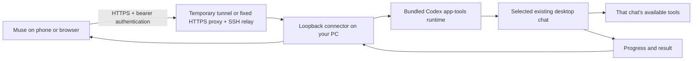

# Muse Local Connector

Use a remote assistant such as Muse to find and continue existing chats in the Codex desktop app on your computer. Requests go to those chats through the desktop's own task tools. Computer requests go to a selected chat as instructions, where its available tools and normal action rules apply.

**Experimental.** This prototype depends on the app-tools runtime bundled with Codex desktop. Manual launch uses a Codex execution environment; optional automatic startup uses a Codex-managed MCP registrar to refresh that context. It is not a standalone Codex CLI integration. Bundled runtime changes can require compatibility work.

This project is independently developed and is not affiliated with Meta, Muse, or OpenAI.

## What it does

- Lists existing tasks and reads recent context.
- Submits an instruction to a chosen existing chat and returns a job ID.
- Polls the desktop for that chat's progress and reply.
- Records local job receipts and deduplicates repeated request IDs.
- Starts with a configured pilot chat, then permits the wider task catalog after verification.

Expanded discovery covers unarchived local Codex tasks through a paginated local catalog. ChatGPT-backed discovery covers recent and pinned chats returned by the desktop; it does not claim to enumerate all cloud history. A known existing chat ID can be routed when the configured scope and native backend permit it.

In expanded mode, `GET /v1/tasks?archived=true&source=codex` lists archived Codex chats with the desktop's opaque pagination cursor. `source=chatgpt` requests the provider's archive when available. Archive discovery does not restore a chat or promise it can accept a new instruction.

The connector does not provide an arbitrary shell endpoint or direct mouse/keyboard API. A `computer` job asks a selected existing desktop chat to use its tools. Tool availability and native approval requirements still determine which actions that chat can perform. A listed chat is not a guarantee that its backend supports every operation.

## Request path



The PC must be running, and Codex must remain available. Foreground app work may require an unlocked desktop. One instruction can take longer than one HTTP request: submit once, retain the job ID, and poll it.

## Requirements

- Node.js 22 or later; no npm runtime dependencies.
- For the Windows scripts, PowerShell 7.2 or later. Setup uses an existing compatible `CodexVault.psm1` when installed, or its own Windows DPAPI credential store for a fresh installation. No separate vault installation is needed.
- A compatible Codex desktop build with bundled app-tools and a working local sign-in.
- Codex CLI for expanded local task discovery. The catalog launches `codex app-server --stdio`; if its JavaScript entry point is not discovered automatically, set `MUSE_CODEX_JS` to the installed absolute `codex.js` path.
- A launch environment created by Codex that supplies its app-tools IPC context and caller chat ID, directly to the manual gateway or through the optional local MCP registrar.
- For remote access, an HTTPS tunnel or equivalent authenticated access path. The loopback URL alone is unreachable from Muse's cloud computer or a phone.
- A remote client that can store and send a bearer credential securely and make REST requests.

## Local setup

Keep private configuration and runtime state outside source control. The Windows setup script generates the bearer credential, stores it through the selected local credential store, and writes its SHA-256 verifier as `tokenSha256` in private configuration. An installed/configured Codex vault is preferred; otherwise the connector stores a Windows DPAPI encrypted credential in the restricted private data directory. Do not paste credentials into a chat or put them in a URL.

From the project directory inside Codex, run the checks and create a pilot configuration using Node 22 or later. Replace the placeholder with an existing idle chat ID obtained from Codex:

```powershell
npm test
.\scripts\setup-windows.ps1 -DataDir "$env:LOCALAPPDATA\MuseLocalConnector" -PilotThreadId "<existing-chat-id>"
```

Use the private config path returned by setup to start the service:

```powershell
.\scripts\start.ps1 -Config "<absolute-private-config.json>"
```

Pass `-Tunnel` to that start script for a temporary remote route when the tunnel tool is available. To run the process in the foreground instead:

```powershell
node src/cli.mjs --config "<absolute-private-config.json>"
```

`MUSE_CONNECTOR_CONFIG` is an alternative way to supply the config path. `npm start` invokes the same CLI. Configuration includes `port` (default `18761`), `dataDir`, `tokenSha256`, `controllerThreadId`, `allowedThreadIds`, `allowAllTasks`, and `publicOrigin`. The listener is fixed to `127.0.0.1`.

To put the existing key on your local clipboard for a secure connector credential field, rerun setup with the same data directory and `-CopyKey`. Setup preserves the existing config and checks that it matches the stored credential. Clear the clipboard after entering the credential.

`controllerThreadId` identifies the chat hosting the connector, while `allowedThreadIds` identifies tasks it may operate on; these serve different purposes. For manual launch, the caller identity can also come from `CODEX_THREAD_ID`, and `CODEX_APP_TOOLS_PIPE_PATH` must be inherited from the Codex environment. With automatic startup, the Codex-managed registrar inherits the desktop endpoint and renews a private context lease; the gateway preserves the configured controller identity. `CODEX_APP_TOOLS_SERVER` optionally selects an explicit installed app-tools server path.

Starting from an unrelated terminal will not recreate the desktop IPC context. If the app-tools connection is unavailable, fix the launch context instead of supplying guessed IPC addresses or copying internal pipe credentials.

See [Muse setup](docs/muse-setup.md) for remote connection and the pilot checks. Read [SECURITY.md](SECURITY.md) before exposing the listener through a tunnel.

For a fixed URL, Windows logon startup, and fresh Codex context registration, see [automatic startup](docs/automatic-startup.md). The logon task can launch Codex and supervise the gateway and a restricted SSH relay. It preserves existing jobs and does not send instructions on startup.

## HTTP interface

All `/v1` endpoints require `Authorization: Bearer <credential>`.

| Endpoint | Purpose |
| --- | --- |
| `GET /health` | Minimal public liveness response. |
| `GET /openapi.json` | Public API schema without local task IDs or credentials. |
| `GET /` | Public setup information without the credential. |
| `GET /v1/status` | Read pilot/expanded mode and backend connection state without private identifiers. |
| `GET /v1/tasks?limit=50&search=example` | List tasks visible under the current configuration; use returned pagination for the expanded local catalog. |
| `GET /v1/tasks/{threadId}?turnLimit=3` | Read recent context for a permitted task. |
| `GET /v1/jobs` | List recent connector jobs. |
| `POST /v1/jobs` | Send one instruction to a permitted existing chat. |
| `GET /v1/jobs/{jobId}` | Poll the actual desktop task status and retrieve a result. |

Example job body; IDs below are placeholders:

```json
{
  "threadId": "existing-chat-id",
  "prompt": "Reply with the connector test phrase. Do not change files.",
  "kind": "task",
  "requestId": "unique-request-id"
}
```

`hostId` is optional when the desktop knows the execution host. `kind` is `task` or `computer`. Both kinds use the native desktop chat path. The job ID is returned by the connector; never derive it from a thread ID. Generate a new request ID for a new instruction. Retry a lost submission with the same request ID and exact body, then poll the returned job. Do not generate a new request ID merely because a response timed out.

Before sending work, read the target task and confirm its identity. If it is busy or requires human input, report that state. Do not send the same instruction to several chats to work around uncertainty.

## Verification gate

1. With `allowAllTasks: false`, permit one existing idle chat in `allowedThreadIds`.
2. Read that chat through the API. Submit a harmless instruction containing a unique test phrase; retrieve its reply and verify the same thread ID.
3. Through that same route, request a harmless computer action, such as using an existing Calculator app to compute `2 + 2`. Verify the resulting app state or screenshot from the desktop task.
4. Only after both checks pass, enable the intended wider task scope. This enables routing across the catalog; it does not launch every task automatically.
5. Connect Muse remotely and repeat a harmless end-to-end check. Local API success alone does not prove that Muse has connected.

Keep personal verification receipts local. Tests should use synthetic IDs and fake desktop responses. Never publish an owner's chat catalog, prompts, screenshots, tunnel secrets, or runtime receipts as demonstration data.

After inspecting the actual replies and computer image, record the two completed correlated jobs using the IDs returned by the connector:

```powershell
node src/cli.mjs proof --config "<absolute-private-config.json>" --kind task --job "<completed-task-job-id>"
node src/cli.mjs proof --config "<absolute-private-config.json>" --kind computer --job "<completed-computer-job-id>" --evidence "<absolute-inspected-image.png>"
node src/cli.mjs expand --config "<absolute-private-config.json>"
```

The computer evidence must be a locally inspected PNG, JPEG, or WebP file. Recording proof checks the completed job's correlation and image format; it does not inspect image contents for you. Expansion requires both recorded proof kinds. Restart the connector to load the expanded configuration.

## Compatibility and limits

| Area | Current approach |
| --- | --- |
| Task control | Bundled desktop app-tools over its supplied local IPC context. |
| Local Codex discovery | Expanded mode merges a paginated unarchived local catalog with desktop results. |
| ChatGPT-backed discovery | Recent and pinned desktop results; full cloud history is not enumerated. |
| Computer control | Instruction delegated to a selected existing desktop chat. |
| Transport to Muse | REST with polling through a temporary HTTPS tunnel or an optional fixed HTTPS proxy and supervised SSH relay. |
| Automatic startup | Optional current-user Windows logon task, supervised gateway/relay, and fresh Codex context registration. |
| Authentication | Bearer credential verified by the local connector. |
| Windows credential storage | Existing Codex vault when available; otherwise a connector-owned DPAPI encrypted file. |
| OAuth | Not implemented. |
| MCP transport | This gateway exposes REST/OpenAPI; a separate remote MCP adapter is not implied. |
| Desktop internals | Experimental; bundled runtime changes can break compatibility. |

The local pilot and Muse round trip were verified on October 15, 2026, on Windows with Node.js 22.22.1, Codex CLI 0.155.1, and the bundled Codex app-tools runtime 0.1.6. Muse authenticated through a temporary Tunnelmole route, continued an existing chat, retrieved its correlated reply, and requested a Calculator action through that same chat. The resulting `6 × 7 = 42` screenshot was independently inspected. Compatibility with other desktop/runtime versions needs separate verification.

On October 16, 2026, a real Windows restart verified the current-user logon task, supervised gateway, restricted SSH relay, and early Codex context registration. Muse then authenticated through the fixed HTTPS route and completed fresh serial chat and Calculator jobs in the original chat. Both results returned to Muse with matching receipts; the fresh `7 × 8 = 56` screenshot was independently inspected. The serial run needed no network retries or action approvals. Earlier connection checks did need read retries, so this is not a latency guarantee. The phone app was not separately tested.

The tested temporary route sometimes took 30–60 seconds or timed out on reads. Use bounded read retries and retain request IDs for submissions; a slow response must not cause another instruction to be sent. Test the route from the actual remote client before entering credentials. See the [transport setup notes](docs/muse-setup.md#optional-manual-transport-tunnelmole).

## Stop and recovery

For manual setup, `stop.ps1` stops its tracked Cloudflare tunnel and connector. For automatic startup, it stops the supervisor and its managed gateway/SSH relay together. Stop manually launched tunnel providers separately. Already accepted instructions may continue inside Codex; inspect the actual chat before deciding whether to interrupt it. Stopping the HTTP server is not proof that a chat's work stopped.

```powershell
.\scripts\stop.ps1 -Config "<absolute-private-config.json>"
```

After a connector restart, reconcile recorded job IDs against the desktop before sending follow-up work. With manual launch, relaunch the connector from a fresh compatible Codex execution environment after Codex restarts or its IPC resets. With automatic startup, wait for fresh registrar context and verify authenticated `/v1/status`; task requests return 503 while that context is unavailable. Do not automatically replay uncertain submissions.

For a configuration-only restart in manual setup with a temporary tunnel already running, use `stop.ps1 -Config "<absolute-private-config.json>" -KeepTunnel`, then start the gateway again. This preserves the tunnel hostname. Supervised startup rejects `-KeepTunnel`; follow the [automatic startup](docs/automatic-startup.md) stop/start procedure instead. See [Muse setup](docs/muse-setup.md) for the manual `set-origin` sequence.

## Open-source status

Released under the [MIT License](LICENSE). The existing-chat and computer-action checks passed locally and from Muse before publication. The tracked release files passed a privacy review; personal configuration, credentials, chat records, and screenshots remain outside the source repository.

For contributions, keep the core portable, use fake data in tests, document compatibility evidence, and avoid copying private Codex pipe implementations or user runtime files into the project.
