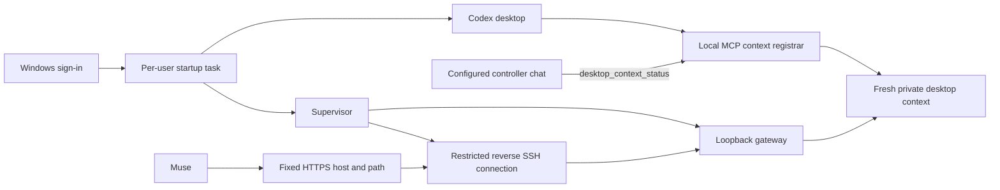

# Automatic startup and a stable address

Use a fixed HTTPS reverse proxy on infrastructure you control, plus the current-user Windows logon task. Windows must be signed in for the desktop app and computer tools. This does not enable automatic Windows sign-in or unlock the computer.



The registrar depends on the app-tools environment supplied by the installed Codex desktop build. That variable is an experimental integration detail, rather than a public compatibility guarantee. Test the installed version. A gateway health response alone does not prove desktop access; authenticated `/v1/status` must also succeed. If Codex has not started its MCP runtime, task requests return 503 until it registers fresh context.

## Register fresh desktop context

Add a local MCP server in the user's Codex configuration, using actual absolute paths:

```toml
[mcp_servers.muse_connector_context]
command = 'C:\Path\To\node.exe'
args = ['C:\Path\To\muse-local-connector\src\context-bridge.mjs', '--config', 'C:\Private\connector\config.json']
env_vars = ['CODEX_APP_TOOLS_PIPE_PATH', 'CODEX_THREAD_ID']
startup_timeout_sec = 10
```

Set `desktopContextFile` in the existing private connector configuration to the absolute `desktop-context.json` path inside its existing `dataDir`. Preserve the original `controllerThreadId`, credential verifier, proof records, and jobs. Do not supply a guessed pipe address or replace the controller with an unrelated chat.

From the configured controller chat, call `desktop_context_status` to activate registration. The registrar validates the actual caller chat and turn metadata supplied by Codex. Starting an MCP process in another chat cannot claim this connector's lease. The activated registrar renews its private lease while its runtime lives; after Codex replaces that runtime, activate the new one from the same controller chat. HTTP startup and the stable address can recover independently, but native execution waits for this owner registration.

The gateway checks freshness before native tool calls and forwards the registered caller turn identity. A same-endpoint renewal preserves requests already in flight; an endpoint change drains those requests before reconnecting. Uncertain sends are not replayed. Keep the context lease and all process records outside Git.

## Configure a fixed HTTPS route

Example additions to the existing private configuration:

```json
{
  "publicOrigin": "https://connector.example",
  "publicBasePath": "/local-connector",
  "desktopContextFile": "C:\\Private\\connector\\desktop-context.json",
  "sshRelay": {
    "host": "my-connector-relay",
    "remotePort": 18762,
    "localPort": 18761
  }
}
```

Use a named SSH-config host backed by a dedicated key in the operating system's agent. The supervisor uses batch authentication and a reverse forward bound to remote loopback. Provision a dedicated server account limited to remote TCP forwarding on that single loopback port. Deny interactive sessions, local forwarding, PTY, agent forwarding, and password authentication. Do not use an unrestricted administration key for the persistent relay.

On an existing HTTPS virtual host, the isolated location can be:

```nginx
location = /local-connector { return 308 /local-connector/; }
location ^~ /local-connector/ {
    proxy_pass http://127.0.0.1:18762/;
    proxy_set_header Host $host;
    proxy_http_version 1.1;
    proxy_buffering off;
    proxy_read_timeout 90s;
    access_log off;
}
```

The trailing slash in `proxy_pass` strips the prefix. The gateway remains bound to local loopback; its Host/Origin restrictions and bearer authentication remain active. Validate Nginx before graceful reload and preserve existing site checks and a rollback copy.

Muse's schema URL is then `https://connector.example/local-connector/openapi.json`. Verify unauthenticated health from Muse, confirm protected endpoints return 401, and enter the existing dedicated key only through Muse's secure key form for the new hostname. Give only that hostname the intended network permission.

## Install and test Windows startup

```powershell
.\scripts\install-startup.ps1 -Config 'C:\Private\connector\config.json' -NodePath 'C:\Path\To\node.exe' -CodexAppUserModelId '<installed-package-family>!App'
```

The optional app ID comes from the installed Codex package manifest. The launcher resolves the current installed executable and opens the original controller using its documented `codex://threads/<id>` link, rather than restoring an unrelated chat or depending on an old protocol registry path. Installation creates one current-user, limited, interactive logon task and records its exact action. It does not start work in any chat. Read `startup-task.json` for the generated task name, then use `Start-ScheduledTask -TaskName '<recorded-name>'` to test the real action without rebooting.

Check the fixed public health and authenticated native status. Test duplicate startup, stop the tracked gateway once and verify recovery, and confirm job history is unchanged. The supervisor keeps retrying failed gateway and relay processes independently, with delays doubling from 1 second to a 30-second cap, until intentionally stopped. A temporary network outage does not exhaust recovery, and reconnection never replays instructions. Windows also retries a failed startup task up to three times at one-minute intervals. A complete computer reboot is a separate test; report whether it was performed.

## Stop and uninstall

```powershell
.\scripts\stop.ps1 -Config 'C:\Private\connector\config.json'
.\scripts\uninstall-startup.ps1 -Config 'C:\Private\connector\config.json'
```

Stop shuts down the supervisor and its managed gateway/relay together. `-KeepTunnel` is for the manual launcher and is rejected for supervised startup. Uninstall checks task ownership before removing only that installation's logon task. Credentials, jobs, configuration, receipts, and remote proxy setup are preserved. Already accepted Codex work may continue in its original chat.
