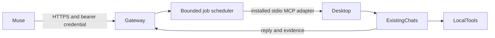

# Muse Local Connector

The owner uses Muse on a phone or browser to continue existing desktop chats and request work on the host computer. The connector preserves the original chat IDs and delegates through the running desktop app's installed tools. It does not create replacement chats or expose a raw shell.

The first release uses Node 22 built-ins and a narrow JSON API. The desktop adapter depends on the installed Codex app-tools plugin and its provided IPC environment; this is an experimental compatibility surface. Local Codex catalog pagination is read-only. All writes go through the desktop task router.

The adapter validates fresh desktop context before admitting each tool request. A renewed lease on the same endpoint reuses the connection. An endpoint change waits for already admitted requests to settle under their existing timeouts before reconnecting. Unavailable context rejects new requests without cancelling authorized calls already in flight; an explicit stop still closes them. Connection handoff never replays a send.

The gateway binds only to loopback. A temporary outbound HTTPS tunnel can make it reachable to Muse. Task endpoints require a dedicated bearer key; only its SHA-256 hash is needed by the server. Windows setup prefers an installed Codex credential vault and otherwise uses a connector-owned Windows DPAPI encrypted file. Configuration, jobs, chat details, screenshots, and audit receipts live outside the source package.

Pilot mode permits one selected existing chat. Expansion requires completed chat and computer proof records tied to real connector jobs. Remote requests cannot expand access. Computer requests stay in a desktop-enabled chat and preserve app permissions and project instructions.

The scheduler defaults to four active jobs, configurable locally from 1 through 32 using `maxConcurrentJobs` or the CLI `concurrency --max-jobs` command. Configuration changes apply after restart. It permits one active connector instruction per existing chat, and all declared browser and desktop work shares one UI lane. Jobs marked `execution: "background"` can use other chats concurrently and receive an explicit instruction against UI tools. Omitted execution defaults to `ui`; `kind: "computer"` cannot request background execution. This schedules declared work, not all tool calls or manually started work on the computer.

Pending jobs return a durable job ID and queue reason. An independent five-second scheduler poll reconciles active work and admits eligible waiting jobs; one busy chat does not block an unrelated eligible chat. Muse should submit independent jobs before polling each result, rather than waiting for each job to finish before submitting the next.

Unattempted queued payloads are persisted separately in private `pending-jobs.json`, then removed after a durable transition to `submitting`. Only untouched queued work is eligible for automatic dispatch after restart. Uncertain submission outcomes retain their job IDs, reconcile against the same existing chats, and are never automatically resent. Pending prompts, jobs, and audit records remain outside source control.

Per-job controls use a separate operation ID and durable private `controls.json` receipt. A queued edit changes only the pending payload and records its previous value; the original submission hash remains stable for retries. A queued cancellation preserves the job record. Active stop and correction use the supported existing-chat message API and require an additional control receipt in a fresh, inactive native final. Sending the message does not release the original reservation. Polls admitted before a control are ignored, and an original reply without the latest control receipt cannot complete the controlled job. A control with an uncertain send outcome is never replayed.

Success means a reply from the same existing chat through this connector, a visibly verified harmless computer action through that route, complete local Codex catalog discovery, and a separately verified Muse connection. Source publication follows the owner's working-for-me gate.
