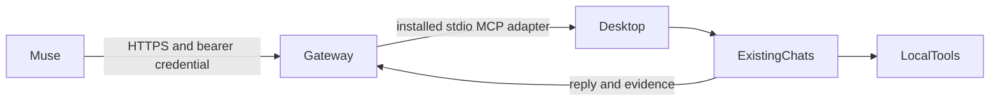

# Muse Local Connector

The owner uses Muse on a phone or browser to continue existing desktop chats and request work on the host computer. The connector preserves the original chat IDs and delegates through the running desktop app's installed tools. It does not create replacement chats or expose a raw shell.

The first release uses Node 22 built-ins and a narrow JSON API. The desktop adapter depends on the installed Codex app-tools plugin and its provided IPC environment; this is an experimental compatibility surface. Local Codex catalog pagination is read-only. All writes go through the desktop task router.

The gateway binds only to loopback. A temporary outbound HTTPS tunnel can make it reachable to Muse. Task endpoints require a dedicated bearer key; only its SHA-256 hash is needed by the server. Windows setup prefers an installed Codex credential vault and otherwise uses a connector-owned Windows DPAPI encrypted file. Configuration, jobs, chat details, screenshots, and audit receipts live outside the source package.

Pilot mode permits one selected existing chat. Expansion requires completed chat and computer proof records tied to real connector jobs. Remote requests cannot expand access. Work is serialized; uncertain submission outcomes are reconciled without retrying. Computer requests stay in a desktop-enabled chat and preserve app permissions and project instructions.

Success means a reply from the same existing chat through this connector, a visibly verified harmless computer action through that route, complete local Codex catalog discovery, and a separately verified Muse connection. Source publication follows the owner's working-for-me gate.
